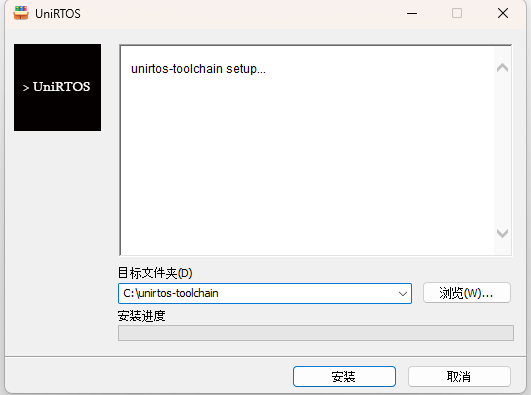
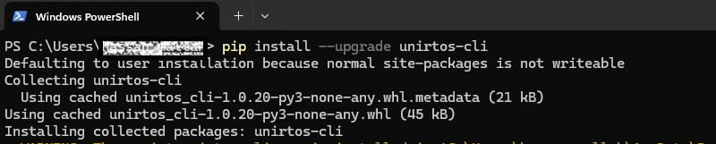
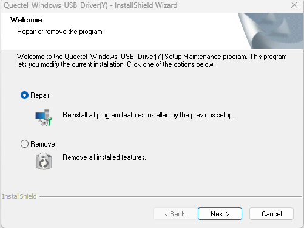
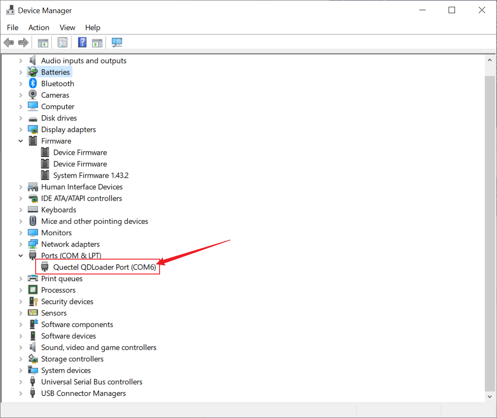

# UniRTOS VS Code Extension User Guide

[简体中文](README.zh-CN.md) | English

## Contents

- [Part 1: User Guide](#part-1-user-guide)
  - [1. Before You Start](#1-before-you-start)
  - [2. Install the Extension](#2-install-the-extension)
  - [3. Quick Tour](#3-quick-tour)
  - [4. Quick Start: Create, Build, Flash](#4-quick-start-create-build-flash)
  - [5. Create a Project from a Demo](#5-create-a-project-from-a-demo)
  - [6. Open an Existing Project](#6-open-an-existing-project)
  - [7. Flashing Details](#7-flashing-details)
  - [8. Serial Debugging and Logs](#8-serial-debugging-and-logs)
  - [9. Feature Reference](#9-feature-reference)
  - [10. FAQ](#10-faq)
  - [11. Feedback](#11-feedback)
- [Part 2: This Workspace](#part-2-this-workspace)

# Part 1: User Guide

## 1. Before You Start

### Development computer

- VS Code is installed on Windows. The extension manifest declares support for VS Code 1.60 and later; a recent stable release is recommended.
- Git is installed and `git --version` works in a terminal.
- Python 3 is installed and available as `python --version` or `python3 --version`.
- The UniRTOS toolchain for the target SDK is installed. If the extension cannot find it when a project command runs, it prompts you to download it.
- The computer can access the Git repositories, Python package index, and toolchain download location.




### Module, driver, and serial ports

- Prepare the target Quectel module, a data-capable USB cable, and firmware that matches the module.
- On Windows, install the Quectel USB driver for your module. The `Welcome` walkthrough provides a driver download entry; run the installer manually after downloading it.
- For flashing, the module must be in a downloadable state and expose the appropriate Quectel AT or QDLoader serial port.
- The `Debug` command depends on `ms-vscode.vscode-serial-monitor`, which is declared as an extension dependency.




### Workspace detection

`Build`, `Clean`, and `Flash` require a UniRTOS project workspace. The extension checks for `env_config.json` at the workspace root or one directory below it, and checks Git, the toolchain, Python 3, and the CLI environment. Open the project root, not just a `main` or `src` subfolder.

## 2. Install the Extension

1. Open the VS Code Extensions view with `Ctrl+Shift+X`.
2. Search for `UniRTOS`, verify that the publisher is `Quectel`, and install it.
3. Click the `UniRTOS` icon in the Activity Bar to open the `Commands` view.
4. On first use, select `Welcome` and follow the prompts for the toolchain, Python, Git, Quectel driver, and UniRTOS CLI.
5. The extension creates a Python virtual environment in its global storage and installs or updates `unirtos_cli` there. You normally do not need to install the CLI into system Python.

## 3. Quick Tour

The UniRTOS Activity Bar view contains two groups: `Development` and `Links`.

| Group | Command | Purpose |
| --- | --- | --- |
| Development | `Welcome` | Open the setup walkthrough |
| Development | `New Project` | Choose a platform, module, SDK version, and destination to create a project |
| Development | `New Project From Demo` | Select a demo and create a project or add it to the current project |
| Development | `Open Existing Project` | Select and open an existing project folder |
| Development | `Clean` | Ask the UniRTOS CLI to clean build artifacts |
| Development | `Build` | Build the current workspace with the UniRTOS CLI |
| Development | `Flash` | Open the firmware flashing view |
| Development | `Debug` | Open Serial Monitor for serial output and interaction |
| Links | `Document Center` | Open the UniRTOS documentation center |
| Links | `Github` | Open the UniRTOS GitHub organization |
| Links | `Forum` | Open the Quectel forum |
| Links | `Offical Website` | Open the UniRTOS official website |

## 4. Quick Start: Create, Build, Flash

### Step 1: Prepare the environment

1. Open the `UniRTOS` view and run `Welcome`.
2. Install Git, Python 3, and the UniRTOS toolchain. Project commands perform environment checks as they run.
3. Install the Quectel USB driver and confirm Windows recognizes the connected module.
4. Make sure Serial Monitor is installed and enabled.

### Step 2: Create a project

1. Select `New Project` under `Development`.
2. Choose the target platform and module, then select an SDK version as offered by the form.
3. Choose a destination folder and enter a project name.
4. Continue. The extension invokes the CLI to create the project, write its configuration, and initialize the environment. VS Code opens the new project when the operation completes.

Project creation requires Git, network access, and write permission for the destination. If it fails, check VS Code notifications and output first.


### Step 3: Build

1. Open the UniRTOS project root in VS Code.
2. Select `Build`.
3. In the `Output` panel, choose the `UniRTOS Build` channel to follow the live log.
4. Wait for the command to finish. If it fails, inspect the earliest error in the log first.

The extension runs `unirtos_cli build -d <project-directory>`. The output location depends on the SDK and CLI.


### Step 4: Flash

1. Keep the target UniRTOS project open.
2. Select `Flash` and choose the detected device port.
3. Select a firmware configuration. The extension searches under `qos_build/release` for `quec_download_usb.ini` or `.hbinpkg`; select the matching file manually if it is not detected.
4. Put the module into download mode as prompted and start flashing.
5. Check the output log for completion and confirm that the device restarts.

The firmware and configuration must match the current build and target module. Keep USB connected and do not power off or unplug the device during flashing.


## 5. Create a Project from a Demo

1. Select `New Project From Demo`.
2. Choose the platform, module, and available demo/version.
3. Choose whether to create a standalone project or add the demo to the current UniRTOS project. A standalone project also requires a destination folder.
4. Continue and wait for the CLI to retrieve the SDK/demo and initialize the project.
5. Verify the opened folder and module configuration before building.

The CLI supplies the demo list. Network or repository access issues may prevent the list from loading.


## 6. Open an Existing Project

1. Select `Open Existing Project` and choose the UniRTOS project root.
2. Confirm that the root contains `env_config.json` and the target module is configured correctly.
3. Select `Build` to compile. Run `Clean` first when a clean rebuild is needed.

The extension uses the current VS Code workspace path. Do not open only a source file or a nested project folder.

## 7. Flashing Details

### Ports and configuration files

The extension scans serial ports and filters for devices whose manufacturer information identifies Quectel. A build configuration is typically located at:

```text
<project-root>/qos_build/release/<version-or-build-folder>/quec_download_usb.ini
```

A project may instead provide an `.hbinpkg` package. Select a file that matches the current build and module.

### Troubleshooting a failed flash

- Check the USB cable, power, and Quectel driver. Confirm the expected port appears in Windows Device Manager.
- Make sure another application is not holding the serial port.
- Reconnect the device and enter the correct download mode.
- Verify that the configuration and firmware came from the latest successful build of this project.
- Review the UniRTOS flashing log in `Output` and record the failing command and error.

## 8. Serial Debugging and Logs

`Debug` opens VS Code Serial Monitor and prompts you to select a debug port. It is for serial log viewing and interaction, not C/C++ source-level breakpoint debugging; it does not configure a JTAG/SWD session automatically.

1. Select `Debug`.
2. Choose the module's log/debug port in Serial Monitor.
3. Set the baud rate and other serial parameters according to the module and firmware configuration.
4. Reset or power-cycle the module and inspect the startup log.

AT, download, and log ports may be different. Check the module hardware documentation. Do not let a serial monitor hold the download port during flashing.

## 9. Feature Reference

### Project management

- `New Project`: create and initialize a project after choosing the platform and module.
- `New Project From Demo`: add an available demo to a new or current project.
- `Open Existing Project`: open an existing UniRTOS project.

### Build management

- `Build`: run the UniRTOS CLI build and show output in the `UniRTOS Build` channel.
- `Clean`: ask the CLI to clean build files. Save and back up important project changes before cleaning.

### Device operations

- `Flash`: select a port and firmware configuration, then run the bundled FlashToolCLI.
- `Debug`: open Serial Monitor for serial output and interaction.

### Documentation links

`Document Center`, `Github`, `Forum`, and `Offical Website` open UniRTOS documentation, the GitHub organization, the forum, and the official website respectively.

## 10. FAQ

### Build says this is not a UniRTOS SDK project

Open the project root containing `env_config.json` and confirm that the extension/CLI version supports this project layout. Opening only the `main` subfolder may fail detection.

### Git is not found

Run `git --version` in a new VS Code terminal. Install Git and restart VS Code so the updated PATH is loaded.

### Python 3 is missing or CLI virtual-environment setup fails

Install Python 3 and make sure at least one of `python`, `python3`, or `py -3` works. Check access to the Python package index. The extension creates its own environment and installs `unirtos_cli`.

### The UniRTOS toolchain is not found

Use the `Welcome` walkthrough or choose the download action in the environment prompt. Restart VS Code after installation and try again.

### Project or demo download fails

Check network access, Git, and write permission for the destination. In VS Code Settings, search for `unirtos.mirrorSource` and choose `github` or `gitee`.

### No serial port appears in the Flash view

Check the USB connection, driver, and device mode. Close applications using the port and scan again. The extension filters for ports whose manufacturer information includes Quectel.

### The flash configuration is not detected

Confirm the build succeeded and check `qos_build/release` for `quec_download_usb.ini` or `.hbinpkg`. Select the matching file manually if needed.

### Debug cannot open Serial Monitor

Make sure `ms-vscode.vscode-serial-monitor` is installed and enabled, then select the correct log port and baud rate.

## 11. Feedback

- UniRTOS documentation center: <https://www.quectel.com.cn/unirtos/software>
- UniRTOS GitHub: <https://github.com/UniRTOS>
- Quectel forum: <https://forums.quectel.com/categories>
- Extension issues: <https://github.com/UniRTOS/UniRTOS-vscode-Extension/issues>

Include the extension and VS Code versions, target module, reproduction steps, expected and actual results, and relevant output logs. Remove credentials, keys, and unique device identifiers before sharing logs.

# Part 2: This Workspace

## 1. Project structure

```text
CMakeLists.txt       External application CMake configuration
main/
  inc/                Application headers
  src/main.c          Demo task and application registration

env_config.json       UniRTOS project configuration
User/                 E-paper drivers, GUI, fonts, and examples
```

`main/src/main.c` creates a task that periodically prints a `hello world` log and registers the application with `UNIRTOS_APP_EXPORT`. The root `CMakeLists.txt` states that the external application is expected to be imported by the UniRTOS SDK root CMake project through `add_subdirectory`.

## 2. Current module configuration

The key fields in the current `env_config.json` are:

```json
{
  "unirtos_root": "",
  "build": { "module": "EG800ZCN_LA" },
  "sdk": { "version": "1.0.5" },
  "libraries": { "list": [] }
}
```

Before building, check whether `unirtos_root` must be set for your SDK installation. Verify that `build.module`, the SDK version, and external libraries match the target project.

## 3. Using the extension with this project

1. Open the project root so the extension can read `env_config.json`.
2. Confirm Git, Python 3, and the UniRTOS toolchain/CLI for the target SDK are ready.
3. Make sure the project is included by the SDK root build system; the current CMake comment expects the SDK root to import it with `add_subdirectory`.
4. Run `Build` and inspect the output log and SDK build artifacts.
5. After a successful build, verify the firmware configuration and target module in `Flash` before programming the device.

This workspace also contains e-paper drivers and examples. The extension invokes the UniRTOS CLI and flashing tool; SPI pins, display selection, and application behavior are controlled by project code, configuration, and the hardware documentation.
