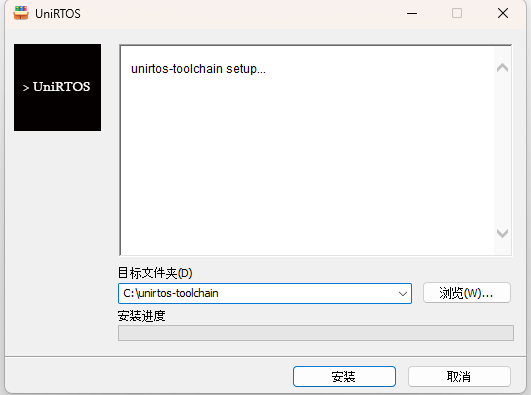
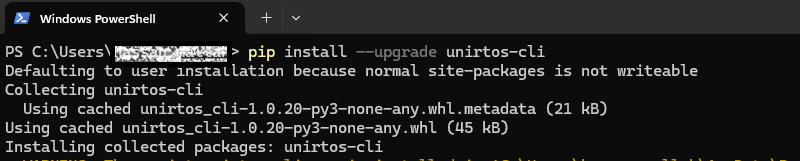
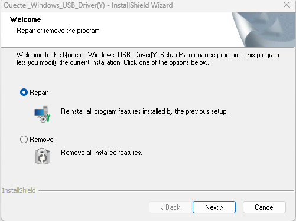
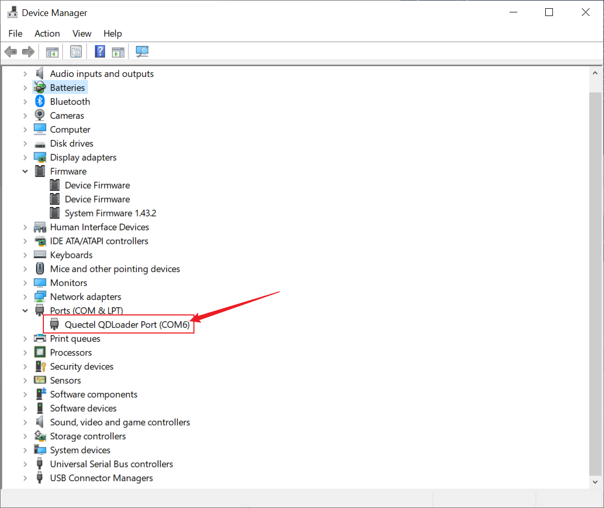

# UniRTOS VS Code 插件使用指南

[English](README.en.md) | 简体中文

## 目录

- [第一部分：用户指南](#第一部分用户指南)
  - [1. 开始之前](#1-开始之前需要准备)
  - [2. 安装插件](#2-安装插件)
  - [3. 界面速览](#3-界面速览)
  - [4. 快速开始：创建、构建、烧录](#4-快速开始创建构建烧录)
  - [5. 从 Demo 创建工程](#5-从-demo-创建工程)
  - [6. 打开已有工程](#6-打开已有工程)
  - [7. 烧录说明](#7-烧录说明)
  - [8. 串口调试与日志](#8-串口调试与日志)
  - [9. 功能详解](#9-功能详解)
  - [10. 常见问题](#10-常见问题)
  - [11. 问题反馈](#11-问题反馈)
- [第二部分：当前工程说明](#第二部分当前工程说明)

# 第一部分：用户指南

## 1. 开始之前（需要准备）

### 开发电脑

- Windows 电脑已安装 VS Code。插件清单声明支持 VS Code 1.60 及以上版本，建议使用较新的稳定版。
- 已安装 Git，并能在终端运行 `git --version`。
- 已安装 Python 3，并能运行 `python --version` 或 `python3 --version`。
- 已安装目标 SDK 对应的 UniRTOS toolchain。首次运行项目命令时，插件检测不到 toolchain 会提示下载。
- 网络可以访问 Git 仓库、Python 包源和工具链下载地址。




### 模组、驱动与串口

- 准备目标 Quectel 模组、可传输数据的 USB 线，以及与目标模块匹配的固件。
- Windows 根据模组型号安装 Quectel USB 驱动。驱动下载入口位于插件 `Welcome` 引导中；下载后需手动运行安装程序。
- 烧录时模组应处于可下载状态，并枚举出 Quectel AT 或 QDLoader 串口。
- `Debug` 命令依赖 `ms-vscode.vscode-serial-monitor` 扩展。UniRTOS 扩展清单将其声明为扩展依赖。




### 工程识别

`Build`、`Clean`、`Flash` 需要打开 UniRTOS 工程工作区。插件检查根目录或其下一层目录中的 `env_config.json`，并检查 Git、toolchain、Python 3 和 CLI 环境。请打开工程根目录，而不是只打开 `main`、`src` 等子目录。

## 2. 安装插件

1. 打开 VS Code 扩展视图，快捷键为 `Ctrl+Shift+X`。
2. 搜索 `UniRTOS`，确认发布者为 `Quectel` 后安装。
3. 点击活动栏中的 `UniRTOS` 图标，打开 `Commands` 视图。
4. 首次使用时点击 `Welcome`，按照引导准备 Toolchain、Python、Git、Quectel 驱动和 UniRTOS CLI。
5. 插件会在 VS Code 扩展全局存储目录创建 Python 虚拟环境，并在其中安装/更新 `unirtos_cli`。通常不需要把 CLI 安装到系统 Python。
可在扩展详情页查看当前安装的插件版本。

## 3. 界面速览

UniRTOS 活动栏面板包含 `Development` 和 `Links` 两组命令：

| 分组 | 命令 | 用途 |
| --- | --- | --- |
| Development | `Welcome` | 打开安装与环境准备引导 |
| Development | `New Project` | 选择平台、模组、SDK 版本和保存位置，创建工程 |
| Development | `New Project From Demo` | 选择 Demo，创建独立工程或加入当前工程 |
| Development | `Open Existing Project` | 选择并打开已有工程目录 |
| Development | `Clean` | 调用 UniRTOS CLI 清理构建产物 |
| Development | `Build` | 调用 UniRTOS CLI 构建当前工作区 |
| Development | `Flash` | 打开固件烧录界面 |
| Development | `Debug` | 打开 Serial Monitor 查看串口输出或交互 |
| Links | `Document Center` | 打开 UniRTOS 文档中心 |
| Links | `Github` | 打开 UniRTOS GitHub 组织页面 |
| Links | `Forum` | 打开 Quectel 论坛 |
| Links | `Offical Website` | 打开 UniRTOS 官方网页 |

## 4. 快速开始：创建、构建、烧录

### 第一步：准备环境

1. 打开 `UniRTOS` 面板并运行 `Welcome`。
2. 安装 Git、Python 3 和 UniRTOS toolchain。构建/工程命令运行时会执行环境检查。
3. 安装 Quectel USB 驱动，并确认 Windows 能识别连接的模组。
4. 确认 Serial Monitor 扩展已启用。

### 第二步：创建工程

1. 点击 `Development` 下的 `New Project`。
2. 选择目标平台和模组，并按页面选项选择 SDK 版本。
3. 选择保存目录并填写工程名称。
4. 点击继续。插件调用 CLI 创建工程、写入配置并执行环境初始化；完成后打开新工程。

创建过程需要 Git、网络和对目标目录的写入权限。失败时先查看 VS Code 通知和输出信息。


### 第三步：构建

1. 在 VS Code 中打开 UniRTOS 工程根目录。
2. 点击 `Build`。
3. 在 `Output` 面板选择 `UniRTOS Build` 通道查看实时日志。
4. 等待命令完成。失败时先检查日志中最早出现的错误。

插件执行的 CLI 命令为 `unirtos_cli build -d <工程目录>`。构建产物位置由具体 SDK/CLI 决定。


### 第四步：烧录

1. 保持当前打开的是目标 UniRTOS 工程。
2. 点击 `Flash`，在烧录面板选择检测到的设备串口。
3. 选择固件配置文件。插件会在 `qos_build/release` 下查找 `quec_download_usb.ini` 或 `.hbinpkg`；未自动找到时可手动选择。
4. 按提示让模组进入下载模式并启动烧录。
5. 查看输出日志，确认烧录结束并观察设备重启状态。

固件和配置必须与本次构建及目标模组匹配。烧录期间保持 USB 连接稳定，不要断电或拔线。


## 5. 从 Demo 创建工程

1. 点击 `New Project From Demo`。
2. 选择平台、模组和可用的 Demo/版本。
3. 选择创建独立工程，或将 Demo 加入当前 UniRTOS 工程。独立工程还需指定保存位置。
4. 点击继续，等待 CLI 获取 SDK/Demo 并完成初始化。
5. 完成后确认打开的目录及模块配置，再构建工程。

Demo 列表由 CLI 获取。网络或仓库访问失败时，列表可能无法加载。


## 6. 打开已有工程

1. 点击 `Open Existing Project` 并选择 UniRTOS 工程根目录。
2. 确认根目录包含 `env_config.json`，且目标模块配置正确。
3. 点击 `Build` 开始构建；需要重新构建时可先运行 `Clean`。

插件从当前 VS Code 工作区获取路径。不要只打开源文件或工程子目录。

## 7. 烧录说明

### 串口和配置文件

插件扫描串口并筛选设备信息中制造商标识为 Quectel 的设备。构建配置通常位于：

```text
<工程根目录>/qos_build/release/<版本或构建目录>/quec_download_usb.ini
```

工程也可能提供 `.hbinpkg` 文件。请选择与当前构建和模组型号匹配的文件。

### 烧录失败排查

- 检查 USB 数据线、供电和 Quectel 驱动，确认设备管理器中可见对应串口。
- 确认串口未被其他程序占用。
- 重新连接设备并进入正确的下载模式。
- 确认配置文件和固件来自当前工程最近一次成功构建。
- 查看 `Output` 中的 UniRTOS 烧录日志，记录失败命令和报错。

## 8. 串口调试与日志

`Debug` 会打开 VS Code Serial Monitor，并提示选择调试端口。它用于串口日志查看和交互，不是 C/C++ 源码级断点调试器，也不会自动配置 JTAG/SWD 调试会话。

1. 点击 `Debug`。
2. 在 Serial Monitor 中选择模组的日志/调试串口。
3. 按模组和固件配置设置波特率等串口参数。
4. 复位或重新上电，观察启动日志。

AT、下载和日志串口可能不同，请参考模组硬件资料确认端口用途。不要在烧录过程中让串口监视器占用下载端口。

## 9. 功能详解

### 工程管理

- `New Project`：选择平台和模组，创建并初始化工程。
- `New Project From Demo`：把可用 Demo 加入新工程或当前工程。
- `Open Existing Project`：打开已有 UniRTOS 工程。

### 构建管理

- `Build`：执行 UniRTOS CLI 构建，日志显示在 `UniRTOS Build` 输出通道。
- `Clean`：调用 CLI 清理构建文件。清理前建议确认工程重要修改已保存并备份。

### 设备操作

- `Flash`：选择串口和固件配置，调用扩展中的 FlashToolCLI 执行烧录。
- `Debug`：打开 Serial Monitor 进行串口查看和交互。

### 资料入口

`Document Center`、`Github`、`Forum` 和 `Offical Website` 分别打开 UniRTOS 文档、代码组织、论坛和官网。

## 10. 常见问题

### Build 提示不是 UniRTOS SDK 工程

打开含 `env_config.json` 的工程根目录，确认插件版本/CLI 支持该工程结构。仅打开 `main` 子目录可能导致检查失败。

### 找不到 Git

在 VS Code 新终端运行 `git --version`。安装 Git 后重启 VS Code，使 PATH 更新。

### 找不到 Python 3 或 CLI 虚拟环境初始化失败

安装 Python 3，并确认 `python`、`python3` 或 `py -3` 至少一个可用。检查网络是否能访问 Python 包源；插件会自行创建虚拟环境并准备 `unirtos_cli`。

### 找不到 UniRTOS toolchain

使用 `Welcome` 引导或在环境检查提示中选择下载。安装完成后重启 VS Code 再试。

### 新建工程或 Demo 下载失败

检查网络、Git 和目录写入权限。打开 VS Code 设置，搜索 `unirtos.mirrorSource`，可将仓库镜像切换为 `github` 或 `gitee`。

### 烧录面板没有串口

检查 USB、驱动和设备模式，关闭占用端口的软件后重新扫描。扩展会筛选制造商标识含 Quectel 的串口。

### 自动找不到烧录配置

确认构建成功，并检查 `qos_build/release` 中是否有 `quec_download_usb.ini` 或 `.hbinpkg`。必要时在烧录面板手动选择匹配文件。

### Debug 无法打开串口监视器

确认 `ms-vscode.vscode-serial-monitor` 已安装并启用，并选择正确的日志串口和波特率。

## 11. 问题反馈

- UniRTOS 文档中心：<https://www.quectel.com.cn/unirtos/software>
- UniRTOS GitHub：<https://github.com/UniRTOS>
- Quectel 论坛：<https://forums.quectel.com/categories>
- 插件问题：<https://github.com/UniRTOS/UniRTOS-vscode-Extension/issues>

反馈时请提供插件/VS Code 版本、目标模组、复现步骤、预期与实际结果，以及相关输出日志。分享日志前请移除账号、密钥和设备唯一标识等敏感信息。

# 第二部分：当前工程说明

## 1. 工程结构

```text
CMakeLists.txt       外部应用 CMake 配置
main/
  inc/                应用头文件
  src/main.c          示例任务与应用注册入口
env_config.json       UniRTOS 工程配置
User/                 电子纸驱动、GUI、字体和示例代码
```

`main/src/main.c` 创建周期性打印 `hello world` 日志的任务，并通过 `UNIRTOS_APP_EXPORT` 注册应用入口。根目录 `CMakeLists.txt` 说明该外部应用应由 UniRTOS SDK 根 CMake 工程通过 `add_subdirectory` 导入。

## 2. 当前模块配置

当前 `env_config.json` 的关键字段如下：

```json
{
  "unirtos_root": "",
  "build": { "module": "EG800ZCN_LA" },
  "sdk": { "version": "1.0.5" },
  "libraries": { "list": [] }
}
```

构建前请根据本机 SDK 检查 `unirtos_root` 是否需要填写，并确认 `build.module`、SDK 版本和外部库列表与目标工程相符。

## 3. 插件与当前工程配合

1. 打开工程根目录，确保插件能读取 `env_config.json`。
2. 确认 Git、Python 3 和目标 SDK 对应的 UniRTOS toolchain/CLI 已准备好。
3. 确认工程已由 SDK 根构建系统接入；当前 CMake 注释要求 SDK 根目录通过 `add_subdirectory` 导入本工程。
4. 运行 `Build` 并检查输出日志和 SDK 生成的构建产物。
5. 构建成功后，在 `Flash` 面板核对固件配置和目标模块后再烧录。

本工作区还包含 e-Paper 驱动及示例。插件负责调用 UniRTOS CLI 和烧录工具；SPI 引脚、屏幕型号和应用行为由工程代码、配置及硬件资料决定。
